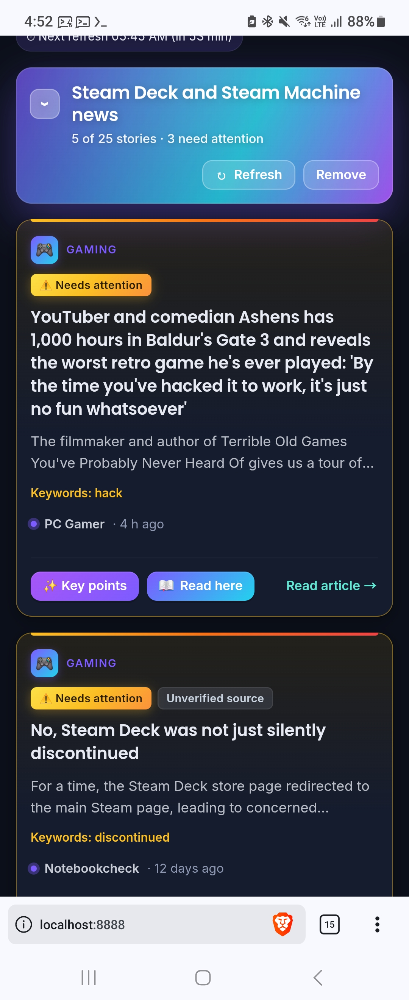

# Gelord x News (gelord-news)

**Version: v1.0.0**

A small news page that runs on your own phone in Termux. You pick the topics, it shows the latest headlines at **http://localhost:8888**.

No AI is used anywhere, and no paid service is needed.

## What it does

1. **News by topic.** Add any topic (for example "electric cars"). Headlines come from Bing News and from a list of site RSS feeds (The Verge, PC Gamer, Engadget, Ars Technica, IGN, BBC News, The Guardian).
2. **Key points without AI.** Tap ✨ *Key points* to get the main sentences of an article, picked by simple rules, not AI.
3. **"Needs attention" highlight.** Stories with words like *hack*, *recall*, *outage* or *discontinued* get a ⚠️ *Needs attention* badge, so you see them first.
4. **Reader view.** Tap 📖 *Read here* to read the article inside the app, without ads.
5. **Night and Day mode.** Dark by default, or switch to Day. A *Compact* view shows more stories at once.
6. **Phone alerts with ntfy (optional).** New "Needs attention" stories can be sent to your phone through the free ntfy app.
7. **Settings.** Choose how often news refreshes (15, 30 or 60 min), how many alerts per topic, turn alerts on or off, and press **Send test** to check that alerts reach your phone.

The server keeps refreshing your topics on its own, even when the page is closed.

## What you need (dependencies)

1. **Termux** from F-Droid or the official Termux site (the Google Play version is old).
2. **python3** (Termux package: `python`). The app only uses Python's built-in modules.
3. **curl** (Termux package: `curl`). Used by the start script to check if the app is already running.
4. **Optional:** the free **ntfy** app (Android: Google Play or F-Droid; iPhone: App Store), only if you want phone alerts.

Install the two packages with:

```
pkg install python curl
```

## Install

1. Download this repo (for example `git clone https://github.com/<you>/gelord-news` or the ZIP from the Releases page).
2. Go into the folder and run the installer:
   ```
   cd gelord-news
   bash install.sh
   ```
3. The installer will:
   1. check for python3 and curl (if one is missing, it shows the `pkg install` command and asks you before running it);
   2. copy the app into `~/MyNews`;
   3. add a starter `topics.json` only if you don't have one yet (your own topics are never overwritten);
   4. ask if you want to start the server now.

## How to use

1. Start the server: `bash ~/MyNews/news.sh`
2. Open **http://localhost:8888** in your phone's browser.
3. Type a topic and tap **Add topic**. Tap a topic to open it.
4. Tap **Refresh** on a topic (or **Refresh all**) to get the newest stories now.
5. On a story: ✨ *Key points*, 📖 *Read here* (reader view), or *Read article* to open the website.
6. Tap **Settings** for refresh time, alerts and your ntfy topic.
7. Stop the server: `bash ~/MyNews/stop.sh`

## Phone alerts with ntfy

1. Install the free ntfy app on your phone.
2. Open **Settings** in the app and tap **Copy** next to *Your ntfy topic* (the server makes a random one for you the first time it starts).
3. In the ntfy app, tap **+** (subscribe) and paste that topic. Keep the server as `ntfy.sh`.
4. Back in Settings, turn on **Phone notifications** and press **Send test**. You should get a test alert.

## Privacy

1. Everything runs on your phone. The page is only reachable from your phone (`127.0.0.1`).
2. **Your ntfy topic works like a password.** Anyone who knows it can read your alerts. Don't share it or post screenshots of it. You can make a new one with **Regenerate** in Settings.
3. Alerts pass through the public **ntfy.sh** service. They contain your topic name, the story headline, its source and link.
4. Your personal files stay on your phone and are never part of this repo: `settings.json` (holds your ntfy topic), `seen.json` (alert history) and `topics.json` (your topics).

## Troubleshooting

1. **"command not found: python3" or "curl"** - run `pkg install python curl`.
2. **Page does not open** - start the server with `bash ~/MyNews/news.sh`, then open http://localhost:8888. Check `~/MyNews/server.log` for errors.
3. **"Address already in use"** - the app is already running. Run `bash ~/MyNews/stop.sh`, then start it again.
4. **No news shows** - check your internet, then tap **Refresh**. If Bing is busy, the app waits a little and tries again; RSS stories still show.
5. **No phone alerts** - check that the ntfy app is subscribed to the exact topic, that *Phone notifications* is on, and press **Send test**.
6. **Server stops when Termux closes** - Android may stop Termux in the background. Use Termux's "Acquire wakelock" in its notification.

## Folder layout

| Path | What it is |
| --- | --- |
| `install.sh` | Installer (copies the app into `~/MyNews`) |
| `app/` | `server.py` (the server) and `index.html` (the page) |
| `config/` | `feeds.json` (RSS sites) and `topics.example.json` (starter topics) |
| `assets/` | `icon.svg` (the app icon) |
| `scripts/` | `news.sh` (start) and `stop.sh` (stop) |
| `screenshots/` | Pictures of the app |

## Screenshots

1. Main page with your topics

   

2. Stories with the "Needs attention" badge, Key points and Read here

   

3. Compact view

   

## About

v1.0.0 - No AI, no paid service, no account needed.
